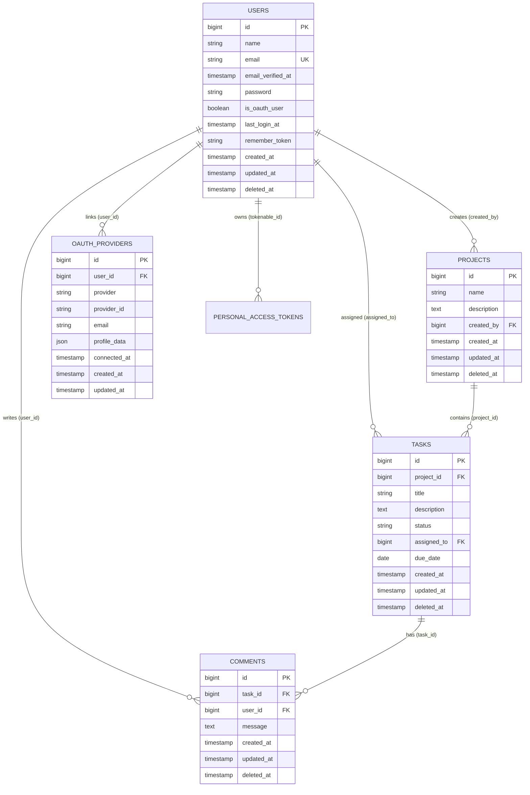

# Entity Relationship Diagram (ERD) & Skema Basis Data

Dokumen arsitektur data, relasi entitas, dan kamus skema tabel untuk repositori backend-task-management.  

---

## 1. Diagram Relasi Entitas (ERD)

---

## 2. Kamus Data Skema Tabel

### 2.1 users
Menampung entitas akun pengguna aplikasi.

| Kolom | Tipe Data | Keterangan |
| :--- | :--- | :--- |
| `id` | BIGINT UNSIGNED | Kunci utama, auto-increment |
| `name` | VARCHAR(255) | Nama lengkap pengguna |
| `email` | VARCHAR(255) | Alamat email unik (*unique index*) |
| `email_verified_at` | TIMESTAMP | Waktu verifikasi email (nullable) |
| `password` | VARCHAR(255) | Hash kata sandi pengguna |
| `is_oauth_user` | BOOLEAN | Penanda login pihak ketiga (default: false) |
| `last_login_at` | TIMESTAMP | Waktu login terakhir (nullable) |
| `remember_token` | VARCHAR(100) | Token remember me bawaan Laravel |
| `created_at` | TIMESTAMP(6) | Waktu pembuatan entitas |
| `updated_at` | TIMESTAMP(6) | Waktu modifikasi terakhir |
| `deleted_at` | TIMESTAMP | Penanda soft delete |

### 2.2 projects
Menampung kontainer proyek yang diinisiasi oleh Admin.

| Kolom | Tipe Data | Keterangan |
| :--- | :--- | :--- |
| `id` | BIGINT UNSIGNED | Kunci utama, auto-increment |
| `name` | VARCHAR(255) | Nama proyek |
| `description` | TEXT | Deskripsi proyek (nullable) |
| `created_by` | BIGINT UNSIGNED | Kunci tamu ke `users.id` (*cascade on delete*) |
| `created_at` | TIMESTAMP(6) | Waktu pembuatan entitas |
| `updated_at` | TIMESTAMP(6) | Waktu modifikasi terakhir |
| `deleted_at` | TIMESTAMP | Penanda soft delete |

### 2.3 tasks
Menampung butir pekerjaan di bawah proyek.

| Kolom | Tipe Data | Keterangan |
| :--- | :--- | :--- |
| `id` | BIGINT UNSIGNED | Kunci utama, auto-increment |
| `project_id` | BIGINT UNSIGNED | Kunci tamu ke `projects.id` (*cascade on delete*) |
| `title` | VARCHAR(255) | Judul tugas |
| `description` | TEXT | Rincian instruksi tugas (nullable) |
| `status` | VARCHAR(50) | Status tugas (`todo`, `in_progress`, `done`) |
| `assigned_to` | BIGINT UNSIGNED | Kunci tamu ke `users.id` (nullable, *null on delete*) |
| `due_date` | DATE | Tenggat waktu penyelesaian (nullable) |
| `created_at` | TIMESTAMP(6) | Waktu pembuatan entitas |
| `updated_at` | TIMESTAMP(6) | Waktu modifikasi terakhir |
| `deleted_at` | TIMESTAMP | Penanda soft delete |

### 2.4 comments
Menampung catatan diskusi pada suatu tugas.

| Kolom | Tipe Data | Keterangan |
| :--- | :--- | :--- |
| `id` | BIGINT UNSIGNED | Kunci utama, auto-increment |
| `task_id` | BIGINT UNSIGNED | Kunci tamu ke `tasks.id` (*cascade on delete*) |
| `user_id` | BIGINT UNSIGNED | Kunci tamu ke `users.id` (*cascade on delete*) |
| `message` | TEXT | Isi pesan komentar |
| `created_at` | TIMESTAMP(6) | Waktu pembuatan entitas |
| `updated_at` | TIMESTAMP(6) | Waktu modifikasi terakhir |
| `deleted_at` | TIMESTAMP | Penanda soft delete |

### 2.5 oauth_providers
Menampung riwayat integrasi penyedia identitas OAuth2 per pengguna.

| Kolom | Tipe Data | Keterangan |
| :--- | :--- | :--- |
| `id` | BIGINT UNSIGNED | Kunci utama, auto-increment |
| `user_id` | BIGINT UNSIGNED | Kunci tamu ke `users.id` (*cascade on delete*) |
| `provider` | VARCHAR(50) | Nama penyedia (`google`, `github`) |
| `provider_id` | VARCHAR(255) | ID unik pengguna dari penyedia |
| `email` | VARCHAR(255) | Email yang diperoleh dari penyedia |
| `profile_data` | JSON | Metadata profil tambahan dari penyedia (nullable) |
| `connected_at` | TIMESTAMP | Waktu penautan akun |
| `created_at` | TIMESTAMP | Waktu pembuatan entitas |
| `updated_at` | TIMESTAMP | Waktu modifikasi terakhir |

*Indeks:* Unique composite index pada `(provider, provider_id)`.
